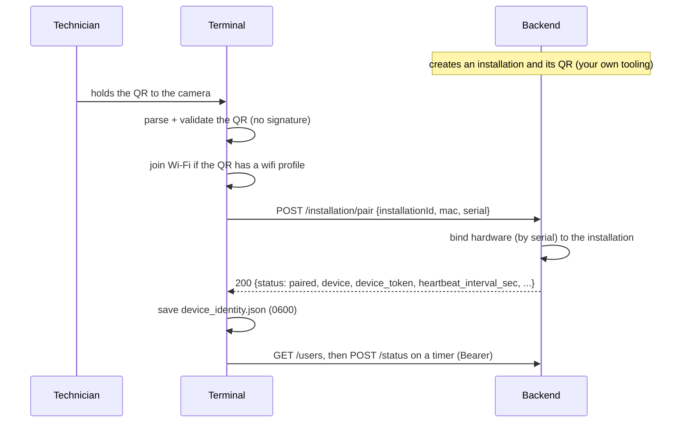

# RSID Face Guard — Device ↔ Server API

> **Scope.** Only what the terminal (the door device) and your backend send
> each other: QR pairing, user list fetch, heartbeat with events, and removal.
> How your backend creates installations, shows QR codes or removes devices
> (dashboard, admin tools) is your own business and is not described here.
> A reference backend is in [server/README.md](../server/README.md).
>
> **Flow in short.** The terminal scans an unsigned installation QR, then calls
> `POST {serverLink}/installation/pair` with `{installationId, mac, serial}`.
> The backend answers with the hardware `device` ID, a `device_token` and a
> `heartbeat_interval_sec`. The terminal then uses the users and status APIs
> below. There is no signature, nonce or one-time token. The old signed-QR flow
> is gone, see [§11](#11-what-changed-from-the-old-contract).

Three endpoints, in the order you will build them.

---

## 1. What you are building

| # | Endpoint | Called by | Auth | How often |
|---|---|---|---|---|
| 1 | `POST /installation/pair` | terminal | none — the installation ID in the body is the credential | once per scan of a QR |
| 2 | `GET /devices/{device_id}/users` | terminal | `Authorization: Bearer <device_token>` | at start-up, right after pairing, then every 60 s |
| 3 | `POST /devices/{device_id}/status` | terminal | `Authorization: Bearer <device_token>` | every `heartbeat_interval_sec` |

Two more things your backend must do, even though they are not endpoints the
terminal calls: produce the installation QR before pairing
([§4](#4-the-installation-qr)) and answer `410` to a removed device
([§9](#9-removing-a-terminal)). How you do either is up to you.

Three facts that shape everything else:

- **The terminal decides access on its own.** It never asks you whether to open
  a door. It matches the card and face against the user list it downloaded from
  endpoint 2 and cached locally, so doors keep working while your backend is
  down. What you control is *what is in that list*.
- **That list is a full replacement set.** Whatever endpoint 2 returns is
  exactly what the door honours from then on. Anyone missing from a usable
  `200` loses access ([§7.3](#73-two-rules-you-must-not-break)).
- **The QR is not signed.** It carries only an installation ID, a device type
  and your backend URL (plus Wi-Fi credentials when you ask for them). The
  reference backend has no expiry on installations, so treat the QR as
  sensitive, especially when it holds a Wi-Fi password.

---

## 2. Conventions

- **HTTPS** with a valid certificate in production. The pairing call does not
  follow redirects, so `serverLink` must be the final URL.
- **Timeout:** the terminal waits `REMOTE_TIMEOUT_SEC` = 10 s for every call.
- **Auth header** on endpoints 2 and 3: `Authorization: Bearer <device_token>`.
  The server answers `401` (`Missing bearer token` / `Invalid device token`) for
  a bad token and `403` (`Token does not belong to this device`) when the token
  belongs to another `device_id`.
- **Timestamps**: UTC, exactly `YYYY-MM-DDTHH:MM:SSZ`, no offsets, no
  fractional seconds. Example: `2026-07-27T15:02:00Z`.
- **Errors**: a JSON body with a `detail` string. For pairing, the terminal
  shows `Pairing failed (<code>): <detail>` to the technician, so write it for
  them.

What the terminal does with each answer:

| Call | Answer | What the terminal does |
|---|---|---|
| Pairing | `2xx` | Checks the body ([§6](#6-post-installationpair--the-terminal-pairs)) and saves its identity. |
| Pairing | any other code | Shows your `detail`. No retry: the technician scans again. |
| Pairing | timeout / unreachable | Shows "Pairing server unreachable or timed out; scan again to recover". Not retried. |
| Heartbeat | `2xx` | Success. Buffered events are deleted. |
| Heartbeat | `410` | **This device was removed.** Wipes identity, users and faceprints ([§9](#9-removing-a-terminal)). Use it for nothing else. |
| Heartbeat | anything else, or network error | A failure. Events stay buffered, the retry delay doubles from the interval up to 300 s, and the door keeps working from cached data. This includes `401`/`403`. |
| User sync | `200` with at least one usable record | Replaces the local list. |
| User sync | non-`200`, network error or unusable body | No change. A `db_sync_failed` event is queued and the next sync tries again. |
| User sync | `200` with no usable record | No change. `db_sync_ok` (`users` = 0) is queued, plus `db_sync_invalid_record` and `db_sync_skipped_entries` for rejected records. No `db_sync_failed`. |

Report your own failures as `5xx`. On heartbeat and user sync only `410` (and
only on heartbeat) is special. On pairing every non-`2xx` is final for that scan.

---

## 3. The flow

### 3.1 Installing a terminal



If pairing fails, nothing is saved on the terminal. The technician fixes the
cause (often by creating a new QR) and scans again.

### 3.2 Normal running

| When | Call | Result |
|---|---|---|
| start-up, after pairing, then every 60 s | `GET /devices/{device_id}/users` | the terminal replaces its whole local user list |
| every `heartbeat_interval_sec` | `POST /devices/{device_id}/status` | `200` means you stored the events, the terminal deletes them |
| after you remove the device | next status call gets `410` | the terminal wipes itself and waits for a new QR ([§9](#9-removing-a-terminal)) |

---

## 4. The installation QR

Before a terminal can pair, your backend creates an *installation* and shows its
QR to the technician. Remember these per installation, because the pair call
returns them: the installation ID, the customer / site / door names, the
`device_mode` and the `network_profile` ([§5](#5-device-mode-and-network-profile)).

The QR holds this compact JSON, with no signature:

```json
{"installationId":"16e467fae6e2692c8255c33a","deviceType":"Genie Door Camera Lite","serverLink":"https://access.example.com"}
```

`networkProfile` is added only for Wi-Fi. A `local` profile is left out to keep
the QR small:

```json
"networkProfile": { "mode": "wifi", "wifi": { "ssid": "acme-installers", "password": "s3cr3t-pass" } }
```

`serverLink` is your public base URL. If it is wrong, the terminal scans fine
and then calls nowhere. The reference backend uses 24 random hex characters for
`installationId`.

What the terminal accepts (`qr_scanner/payload.py`):

- `installationId`, `deviceType`, `serverLink` must be non-empty strings.
- `serverLink` must be `http` or `https`, have a host and a valid port, and have
  no user name, password, query or fragment.
- `networkProfile` is optional. `{}` means local. `mode` must be `wifi` or
  `local`, and `wifi` needs a non-empty `ssid` and `password`.
- Anything else is rejected: the terminal logs it and queues a `qr_rejected`
  event.

On a good scan the terminal queues `qr_accepted` and, **before** the pair call,
joins the Wi-Fi network if the QR has one (`APPLY_NETWORK_PROFILE` is on). A
fresh terminal may have no other route to your backend.

The scanner reads the same camera frame the preview shows, which is cropped to
the centre square. Keep the QR near the middle of the picture.

---

## 5. Device mode and network profile

Your backend chooses these per installation. The terminal gets `device_mode` in
the pair response and the Wi-Fi block in the QR.

| `device_mode` | Behaviour at the door |
|---|---|
| `card_only` | Valid, active card opens the relay. No face step. |
| `card_and_face` | Valid card starts a session, then the face is verified against that cardholder. **Normal production mode.** |
| `face_only` | Screen tap starts a face search against all enrolled users. For doors with no card reader. |
| `time_registry` | IN/OUT attendance. No relay. See [§10](#10-time_registry-mode). |

The terminal applies the mode **at boot**. If a new pairing returns a different
mode than the one running, the screen says "Restart for <mode>". When the
response has no mode, the terminal keeps its own `config.DEVICE_MODE`
(`face_only`). The reference backend defaults to `card_and_face`.

`network_profile` is `{"mode": "local"}` (terminal is cabled, the default) or
`{"mode": "wifi", "wifi": {"ssid": "...", "password": "..."}}`.

---

## 6. `POST /installation/pair` — the terminal pairs

The terminal calls this after it accepts the QR and joins Wi-Fi if needed. **No
`Authorization` header.**

### Request

```json
{
  "installationId": "16e467fae6e2692c8255c33a",
  "mac": "AA:BB:CC:DD:EE:FF",
  "serial": "10000000abcd1234"
}
```

- `mac` must look like `xx:xx:xx:xx:xx:xx`, otherwise the server answers `422`.
  The terminal sends it in upper case.
- `serial` is the Raspberry Pi board serial, 16 hex digits (zero-padded). The
  server stores it in lower case and uses it as the **hardware key**. Windows
  development boxes send `dev-<name>`.

### What the server does, in one transaction

1. The installation must exist (`404` otherwise).
2. Its status must be `pending` or `paired`. Any other status gives `409`.
3. A repeat call for an already `paired` installation is accepted only from the
   same hardware (same serial, same MAC, still active). Otherwise `409`.
4. The hardware row is found by serial, or created with a new random ID.
5. The device row is created or updated, with a **new token**. The old token
   stops working.
6. Pairing a `pending` installation (first pairing, or moving known hardware to a new installation) marks any older installation of that hardware as `replaced` and **resets the device user list to the demo template**, discarding uploaded users. A repeat call for an already `paired` installation keeps the uploaded users.

### Response — `200`

```json
{
  "_id": "16e467fae6e2692c8255c33a",
  "status": "paired",
  "deviceType": "Genie Door Camera Lite",
  "customer": { "_id": "acme", "name": "acme", "serverType": "remote", "serverLink": "https://access.example.com" },
  "venue": "hq",
  "gate": { "_id": "main-entrance", "name": "main-entrance", "status": true },
  "device": "3f9a2c7e5b184d6fa91c7e2b",
  "device_mode": "card_and_face",
  "network_profile": { "mode": "local" },
  "timeStamp": "2026-07-27T15:02:00Z",
  "device_token": "v8Kq2Xn5Rt7Yw1Zb4Ce6Df9Gh0Jk3Lm5Np8Qr1St4Uv",
  "heartbeat_interval_sec": 30
}
```

The terminal requires `status` = `paired`, an `_id` equal to the one it sent, and
a non-empty `device` string. Otherwise it reports "Invalid pair response" and
saves nothing. It reads:

| Response field | Stored as |
|---|---|
| `device` | `device_id`, used in the users and status URLs |
| `device_token` | the bearer token. If it is missing the terminal pairs but has no database credentials, and shows a warning. |
| `customer._id`, `venue`, `gate._id` | `customer_id`, `site_id`, `door_id` |
| `device_mode` | `device_mode` (empty keeps the local default) |
| `heartbeat_interval_sec` | heartbeat rate. Must be above 0. Without it the terminal uses its own 10 s. |

`device_token` is a plain field in the pair response. The terminal stores it in
`device_identity.json` (mode 0600). The server keeps only a hash. Do not log it.

### Failures

| Status | Condition | `detail` |
|---|---|---|
| `404` | Installation unknown | `Installation not found; generate a QR on this server` |
| `409` | Installation replaced or removed | `Installation is no longer active; generate a new QR` |
| `409` | Paired already, or by other hardware | `Installation is already paired or device was removed; generate a new QR` |
| `422` | Bad `mac`, bad `serial` (not a nonzero Pi serial or `dev-...`), or an empty field | validation errors. `detail` is a list here, so the terminal shows that list raw in `Pairing failed (422): ...`. |

### Moving a terminal

Moving a terminal to another door is a new installation and a new QR. Being
already bound is not an error: the terminal replaces its identity, stops the old
heartbeat and restarts it with the new credentials. If it cannot save the new
identity it keeps the old one, but the server has already rotated the token, so
it needs another scan.

### The saved identity (`device_identity.json`)

`device_id`, `device_token`, `server_url`, `customer_id`, `site_id`, `door_id`,
`network_profile`, `device_mode`, `registered_at`, `heartbeat_interval_sec`,
`identity_version` (2), `installation_id`, `serial`, `mac`, `device_type`.
Unknown keys are ignored on load, so a newer server may add fields.

---

## 7. `GET /devices/{device_id}/users` — the door's user list

Bearer authenticated. This is the data the door runs on. Return **only the users
allowed through this terminal's door**. Today our server keeps one user list per
device and returns it.

### Response — `200`

A JSON object keyed by card/badge id:

```json
{
  "2325780402": {
    "user_id": 1,
    "name": "Emma Stone",
    "active": true,
    "permission_level": "employee",
    "faceprints": {
      "version": 9,
      "features_type": 0,
      "flags": 3,
      "adaptive_descriptor_nomask": [-142, 87, -310, 455, 12, 2, 0, 0]
    }
  }
}
```

The array is shortened here. A real one has exactly 515 integers. The terminal
also accepts `{"users": {...}}` or a list of records that each carry `badge_id`
(or `id`), but use the plain object above.

### 7.1 Record fields

| Field | Required | Notes |
|---|---|---|
| *(the key)* | yes | Card/badge id as the reader reads it. Treated as a string. |
| `user_id` | **yes** | Any non-null integer or string. A record without it is skipped and a `db_sync_invalid_record` event is queued. This, never the card id, identifies the person in events. |
| `faceprints` | **yes** | Needs `version`, `features_type`, `flags` and `adaptive_descriptor_nomask`. Otherwise the record is skipped. |
| `name` | no | Default `""`. |
| `active` | no | `false` keeps the record but never opens the door. Default `true`. |
| `permission_level` | no | Informational only. Default `"User"`. |

The terminal keeps only the four `faceprints` keys. Anything else
(`adaptive_descriptor_withmask`, `enroll_descriptor`) is dropped, so do not send
them.

### 7.2 The `faceprints` object

Pass it through exactly as it was given at enrolment. Do not round, reorder or
convert the numbers.

| Key | Value |
|---|---|
| `version` | Currently **9**. Must match the firmware, or comparisons fail. |
| `features_type` | `0` in practice. |
| `flags` | `3` in practice. |
| `adaptive_descriptor_nomask` | **Exactly 515** integers, each within ±1023. |

The terminal does **not** check the length, range or version at sync. These
limits come from the earlier version of this document and the SDK, and were
not re-tested. A wrong array is rejected later by the SDK, when that person shows
their face.

### 7.3 Two rules you must not break

**(a) Only this door's users.** A present, `active` record is the permission
itself. There are no schedules or per-door rules on the device.

**(b) Send the complete list.** A usable `200` replaces the local list. Anyone
missing from it is deleted from the device, faceprints and all, and a
`db_users_revoked` event is queued.

- Never return a partial list (slow query, paging, failed read). Return `5xx`
  instead. The terminal keeps its list and retries.
- **An empty result changes nothing.** If a `200` has no usable record (`{}`, or
  every record invalid), the terminal keeps its old list and queues no
  `db_users_revoked`. So you cannot remove the last user by returning an empty
  list. Set that user `active: false` instead.

### 7.4 What a bad record does

| Problem | Result |
|---|---|
| Missing `user_id`, or a missing `faceprints` key | Record skipped. `db_sync_invalid_record`, then `db_sync_skipped_entries`. |
| A record that is not a JSON object | Skipped and counted in `db_sync_skipped_entries`. No `db_sync_invalid_record` is queued. |
| Array of the wrong length | The SDK rejects it when that person presents their face. |
| Wrong `version` | Matching fails for that data. |

Treat `db_sync_invalid_record` and `db_sync_skipped_entries` as bugs on your
side.

---

## 8. `POST /devices/{device_id}/status` — heartbeat and events

Bearer authenticated, sent every `heartbeat_interval_sec` (never faster than
5 s). It reports the device state and carries any queued events.

### Request

```json
{
  "status": "online",
  "metadata": {
    "app_version": "face-guard",
    "device_type": "F455",
    "serial_port": "/dev/ttyACM0",
    "user_count": 42,
    "camera_available": true,
    "relay_available": true,
    "session_active": false,
    "init_mode_active": false,
    "auth_in_progress": false,
    "storage": { "path": "/", "total_mb": 29820.0, "used_mb": 17540.0, "free_mb": 12280.0, "free_pct": 41.2, "low": false },
    "events": [
      { "event_id": "b2c4e6f8-1a3c-4d5e-8f90-2b4d6e8a0c1f", "type": "access_granted", "ts": "2026-07-27T15:04:11Z", "user_id": 1, "method": "card" }
    ]
  }
}
```

`status` is `online` normally and `shutting_down` on the final flush. Treat
`metadata` as an **open object**: store it, do not validate it. Our server
removes `events` from it before storing the rest.

### Response — `200`

```json
{ "ok": true, "server_time": "2026-07-27T15:04:12Z" }
```

The terminal only looks at the status code. It does not read configuration back,
so a new `device_mode` or `heartbeat_interval_sec` here has no effect.

### 8.1 Events: store them before you answer `200`

Events sit in a 200-entry memory buffer on the device (oldest dropped first) and
are deleted **when you answer `2xx`**.

- `2xx` means every event in the array is stored. Persist first, then answer.
- Any other answer keeps them buffered, and the terminal resends them.
- Ignore duplicate `event_id`s (`INSERT OR IGNORE`). A lost response makes the
  terminal resend the same IDs.
- Our server silently skips an event that has no `event_id` or no `type`, and
  still answers `2xx`.
- Our server keeps at most 500 events per device (`EVENTS_LIMIT`) and 200
  heartbeats (`STATUS_HISTORY_LIMIT`).

Every event has `event_id` (uuid4), `type`, `ts` (device clock, UTC) and
type-specific fields. Record your own `received_at` too.

### 8.2 Event types

Store `type` as a string and accept unknown types.

| Type | Meaning and extra fields |
|---|---|
| `access_granted` | Door opened. `user_id`, `method` |
| `access_denied` | Refused. `reason`: `card_unregistered`, `user_inactive`, `no_match`, `face_mismatch`, `no_faceprints_on_file` or `face_extraction_failed`. Plus `user_id` and `method` when known. `face_extraction_failed` also carries `status`. |
| `access_output_failed` | Access approved but the relay pulse failed |
| `auth_matched` | Face matched, logged before the access decision |
| `relay_opened` | Relay triggered. `seconds` |
| `card_unregistered` | Card is not in the device's list |
| `attendance_event` | `time_registry` check-in: `user_id`, `direction` (`in`/`out`), `method` |
| `device_boot` / `device_shutdown` | Terminal started / stopped |
| `device_revoked` | Terminal is wiping itself after a `410` (see §9) |
| `init_mode_entered` | Terminal is waiting for a QR |
| `qr_accepted` / `qr_rejected` | QR scan outcome. `qr_accepted` carries `installation_id`. |
| `db_sync_ok` | `users`, `skipped` |
| `db_sync_failed` | `reason`: `network_error`, `http_error` (with `status`), `invalid_json`, `unexpected_payload_shape`, `unexpected_payload_type` or `exception`. `network_error` and `exception` also carry `error`. |
| `db_sync_invalid_record` / `db_sync_skipped_entries` | **Records you sent that we could not use** |
| `db_users_revoked` | `count` users deleted locally because they were missing from your list |
| `heartbeat_post_failed` | Three heartbeats in a row failed. Delivered with the next good one. |
| `hardware_error` | Camera, card reader, relay or QR-scanner fault |
| `storage_low` / `storage_ok` | Disk space crossed a threshold. both carry `path` and `free_mb`; `storage_low` also carries `min_free_mb` |

Events identify a person by `user_id`, never by card id or name. The exception
is `db_sync_invalid_record`, which carries the `badge_id` of the bad record.

---

## 9. Removing a terminal

The terminal never asks to be removed and never calls a remove endpoint. Your
backend tells it by answering **`410`** to a status call. Who removes the device
and how (dashboard, admin tool) is your own business. The terminal only reacts
to the `410`.

### 9.1 Keep a record of the device

A hard delete cannot revoke anything. The token would resolve to nothing, the
heartbeat would get `401`, and the terminal would back off, retry forever, keep
its users and keep opening the door. Only `410` triggers the wipe. So when a
device is removed, keep a record of it:

| State | Meaning | Answer to `POST /status` |
|---|---|---|
| active | Normal | `200` |
| removed, not told yet | Removed on your side | `410`, then move to "told" |
| removed, told | The terminal has seen the `410` | `410` |
| *(record deleted)* | Cleaned up after it was told | `401` |

Delete the record only after the terminal has been told. A terminal that is
switched off gets told at its next boot.

### 9.2 What the terminal does

- It reacts on the **next heartbeat**, or at the next boot if it was off.
- On `410` it queues `device_revoked`, tries one final status POST, deletes its
  identity, stops sync, **erases all users and faceprints**, and returns to init
  mode (deny everyone) waiting for a QR.
- **That final POST is not stored by the reference backend.** It carries the old
  token and gets `410` again, so `device_revoked` never arrives. Use your own
  "told" state as the proof that the wipe was ordered.
- **The users endpoint should not rely on `410`.** The terminal treats any
  non-`200` there as a failed sync and does not wipe. The reference backend only
  checks the token there, so a removed terminal can still fetch users until its
  next heartbeat.
- There is no un-remove. A new QR pairs the same hardware again. The reference
  backend finds the record by serial, so the `device_id` stays the same if the
  record still exists, and the device becomes active again. After the record is
  deleted the device gets a new `device_id`.
- To disable a *person*, set `active: false` ([§7.1](#71-record-fields)).

---


## 10. `time_registry` mode

Built on both sides. The terminal shows an IN/OUT screen instead of a
screensaver and does not trigger the relay. A valid, active card queues one
`attendance_event` with `user_id`, `direction` and `method: "card"`. The reader
is held off for the result hold, so one tap is one event.

Attendance events travel in the normal heartbeat with the same `event_id`
handling. They sit in the **memory** buffer like every other event, not on disk,
so a power cut, or more than 200 events during an outage, loses them.

---

## 11. What changed from the old contract

| Old | Now |
|---|---|
| Ed25519-signed QR with nonce and expiry | Plain QR with `installationId`, `deviceType`, `serverLink` |
| `POST /devices/register` with a one-time token (terminal side) | `POST /installation/pair` with `{installationId, mac, serial}` |
| Terminal verifies a signature offline | No signature. Pairing does not use `provisioning_keys/`. |
| Server mints a new `device_id` per registration | Hardware is keyed by Pi serial and keeps its `device_id` |
| `device_mode` and `network_profile` signed into the QR flow | Chosen by the backend per installation, returned by pair. Wi-Fi rides in the QR. |
| User sync every 600 s | Every 60 s (`DB_SYNC_INTERVAL_SEC`) and once right after pairing |
| Heartbeat every 30 s, fixed | `heartbeat_interval_sec` from the pair response (30 s on our server) |
| `401`/`403` on heartbeat: "nothing stops" | Counts as a failed beat: backoff up to 300 s, door keeps working |
| `410` also on users | Only on status |
| `device_revoked` arrives after `410` | It is not stored |
| An empty list wipes users | An empty or fully invalid list changes nothing |
| `time_registry` not implemented | Implemented |
