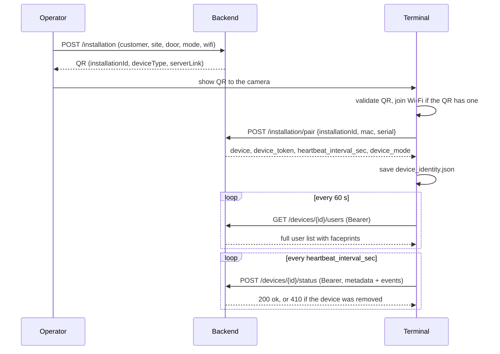

# Terminal ↔ backend:

Full contract: [DEVICE_SERVER_API.md](DEVICE_SERVER_API.md). Short reference: [API_REFERENCE.md](API_REFERENCE.md).

## Big picture
- The terminal is the client. It always calls the backend, and the backend never calls the terminal.
- The terminal decides access locally, from a cached user list. The backend only supplies that list and collects status and events.
- Three endpoints are involved: `pair`, `users` and `status`.

## Step by step
1. **Create an installation.** In the dashboard (`/new`) or via `POST /installation`, you pick a customer, site and door. You also pick the device mode and, optionally, Wi-Fi. The backend stores it as `pending` and returns a QR.
2. **Scan the QR.** The QR is plain JSON with `installationId`, `deviceType` and `serverLink`. It also carries `networkProfile` when Wi-Fi is needed. It is not signed and has no expiry, so treat it as sensitive.
3. **Join Wi-Fi.** If the QR has a Wi-Fi profile, the terminal connects first, because it may have no other route to the backend.
4. **Pair.** The terminal calls `POST {serverLink}/installation/pair` with the installation ID, its MAC and its Pi serial. There is no auth header.
   - The backend binds the hardware, keyed by serial, to the installation.
   - It issues a new `device_token`, and the old one stops working.
   - The reply includes `device` (the device ID), `device_mode` and `heartbeat_interval_sec`.
   - A new pairing resets the device's users to the demo template.
5. **Save identity.** The terminal writes `device_identity.json` (mode 0600). This survives reboots, so it needs no rescan.
6. **Sync users.** `GET /devices/{id}/users` with `Authorization: Bearer <token>` runs once after pairing and then every 60 s.
   - The result is a full replacement set, keyed by card or badge ID.
   - Each record needs `user_id` and a `faceprints` object.
   - A non-`200`, empty or fully invalid response changes nothing.
   - A user missing from a good response is deleted on the terminal.
7. **Heartbeat.** `POST /devices/{id}/status` runs every `heartbeat_interval_sec`, at least 5 s apart.
   - The body is `{status, metadata}`. The `metadata` holds device state plus an `events` array.
   - On `200`, the terminal deletes the sent events. Otherwise it keeps them and retries with backoff up to 300 s.
   - The backend stores events idempotently by `event_id` and answers `{ok, server_time}`.
8. **Door use.** The terminal matches cards and faces against its local cache, so doors still work if the backend is down. It reports `access_granted`, `access_denied` and similar events through the heartbeat.
9. **Removal.** If the device row is suspended, the next status call gets `410`.
   - The terminal sends one last event flush, deletes its identity, wipes users and faceprints, and returns to QR-scan mode.
   - The backend keeps a tombstone until the terminal has been told. A hard delete would give `401` instead, and the terminal would not wipe itself.

## Things to remember
- **Auth:** pairing needs none. `users` and `status` use the Bearer token, and the token must belong to the `device_id` in the URL.
- **Status codes:** only `410` on status triggers a wipe. `401` and `403` are treated as ordinary failures.
- **Mode changes:** a new `device_mode` applies only after a restart. The screen says "Restart for <mode>".
- **Removing the last user:** an empty list never wipes the terminal. Set that user to `active: false` instead.
- **Heartbeat interval:** the test server hands out 30 s. The terminal's own fallback is 10 s.
- **Test server:** `server/README.md` covers running it. Swagger is at `http://localhost:8000/docs`.
